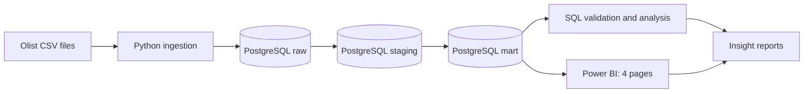

# Olist E-Commerce Analytics Pipeline

**End-to-end e-commerce analytics portfolio | Python · PostgreSQL · SQL · Power BI**

An analytics project built on the **Brazilian Olist E-Commerce public dataset**. It takes source CSV files through a Python ingestion pipeline and a layered PostgreSQL data model, validates reporting KPIs against SQL, and presents actionable findings through a four-page Power BI report.

> **Data coverage:** Historical Olist transactions, approximately September 2016–August 2018 for the primary dashboards. The dataset is historical, not a live production feed. Monetary values are in **Brazilian real (BRL)**.

## Dashboard Preview

The Power BI file is available at [`dashboards/Olist.pbix`](dashboards/Olist.pbix). The report contains four pages:

| Dashboard page | Focus | Preview |
|---|---|---|
| **Executive Overview** | Orders, delivered-product revenue, AOV, monthly revenue, leading categories | [Screenshot](dashboards/screenshots/01_executive_overview.png) |
| **Customer Analytics** | Active and repeat customers, new vs. returning customers, customer geography | [Screenshot](dashboards/screenshots/02_customer_analytics.png) |
| **Delivery Performance** | On-time and late deliveries, delivery duration, differences by customer state | [Screenshot](dashboards/screenshots/03_delivery_performance.png) |
| **Seller Performance** | Active sellers, seller sales, leading categories, seller geography and order volume | [Screenshot](dashboards/screenshots/04_seller_performance.png) |

**Screenshot note:** Add the four exported Power BI screenshots at the relative paths above if they are not already present. The links will work once those files are committed.

## Business Questions

- How much delivered-product revenue was generated, and how did it change month to month?
- Was revenue growth driven by more orders, higher average order value (AOV), or both?
- How often did customers purchase again, and what do monthly acquisition cohorts reveal?
- Which customer states experienced higher delivery delay rates or larger volumes of late orders?
- How concentrated was revenue among sellers, and which product categories contributed to growth?

## Verified KPI Snapshot

The following **all-period / All-slicer** KPI totals were cross-checked between PostgreSQL and the displayed Power BI results. The BI report may show abbreviated or rounded values.

| Metric | Result |
|---|---:|
| Total orders | **99,441** |
| Delivered orders | **96,478** |
| Delivered product sales (excluding freight) | **BRL 13,221,498.11** |
| Average order value (delivered sales / delivered orders) | **BRL 137.04** |
| Active customers (at least one delivered order) | **93,358** |
| Repeat customers (at least two delivered orders) | **2,801** |
| Repeat customer rate | **3.00%** |
| Valid deliveries for delivery-time metrics | **96,470** |
| On-time / late deliveries | **89,936 / 6,534** |
| On-time / late delivery rate | **93.23% / 6.77%** |
| Average / median delivery duration | **12.50 / 10.00 days** |
| Total / active sellers | **3,095 / 2,970** |
| Average delivered-product sales per total seller | **BRL 4,271.89** |

**Important definitions:** Delivered-product sales exclude freight. A *valid delivery* is a delivered order with a usable delivery timestamp and non-negative delivery duration; **8** delivered orders are excluded from the delivery-time calculations. *Active seller* means a seller with at least one delivered order in the observation window. Full definitions and reconciliation details: [`docs/data_validation_report.md`](docs/data_validation_report.md).

## Selected Business Insights

| Finding | Evidence | Recommended next step |
|---|---|---|
| **November 2017 growth was volume-led** | Revenue increased **52.37% MoM** to **BRL 987,765.37**; delivered orders increased **62.77%** while AOV decreased from **BRL 144.76** to **BRL 135.51** | Investigate product mix and seasonal promotions before attributing cause |
| **Repeat purchasing was uncommon in the observed period** | **90,557 / 93,358 (97.00%)** customers had exactly one delivered order | Explore segment-level retention and cohort behavior; account for limited observation windows |
| **Next-month cohort retention was low** | M1 monthly retention ranged **0.18%–0.72%** across 14 cohorts with six months of follow-up | Test targeted retention hypotheses, especially by purchase category |
| **Delivery performance varied by region** | Alagoas: **21.41%** late rate (397 valid orders); Rio de Janeiro: **12.11%** late rate and **1,495** late orders | Prioritize route/carrier analysis by both delay rate and order volume |
| **Seller revenue was concentrated** | Top **310** of **3,095** sellers generated **68.03%** of delivered-product sales | Monitor concentration and seller-development opportunities |

**Interpretation:** These are descriptive findings and diagnostic leads, **not causal conclusions**. Details, context, limitations and recommendations: [`docs/business_insights_report.md`](docs/business_insights_report.md).

## Architecture



### Data layers

| Layer | Responsibility |
|---|---|
| `raw` | Preserve imported source fields for profiling and traceability |
| `staging` | Standardize types, timestamps, null handling and analysis-ready entities |
| `mart` | Build reporting fact tables and dimensions, plus the customer activity view |
| Power BI semantic model | Define relationships, DAX measures, slicers and report visualizations |

Key `mart` objects used in this project include `fact_orders`, `fact_order_items`, `dim_date`, `dim_customers`, `dim_products`, `dim_sellers`, and `customer_order_activity`.

## Tech Stack

**Python** for CSV ingestion and database connectivity; **PostgreSQL** for storage, SQL transformations, analytical marts, CTEs and window functions; **DBeaver** for SQL development and validation; **Power BI Desktop / DAX** for interactive reporting; **Markdown and GitHub** for documentation.

## Repository Layout

The file and folder names below follow the existing project layout:

```text
olist-ecommerce-analytics-pipeline/
├── data/
│   └── raw/                       # Nine source CSVs (can remain local)
├── pipeline/
│   ├── database.py                # Database connection configuration
│   ├── ingest.py                  # CSV ingestion
│   └── test_connection.py         # Connection test
├── sql/
│   ├── data_profiling.sql
│   ├── data_staging.sql
│   ├── data_mart.sql
│   ├── data_validation_pb.sql
│   ├── business_insights.sql
│   └── analysis/
│       ├── 01_monthly_revenue.sql
│       ├── 02_top_categories.sql
│       ├── 03_repeat_customers.sql
│       ├── 04_delivery_performance.sql
│       ├── 05_rfm_analysis.sql
│       └── 06_seller_performance.sql
├── dashboards/
│   ├── Olist.pbix
│   └── screenshots/               # Exported PNGs, if added
├── docs/
│   ├── data_quality_report.md
│   ├── staging_validation.md
│   ├── data_mart_validation.md
│   ├── data_validation_report.md
│   ├── business_analysis_report.md
│   └── business_insights_report.md
├── .env.example                   # Safe connection-variable template, if added
├── .gitignore
├── requirements.txt
└── README.md
```

*Only commit files that actually exist. Optional supporting files and screenshots should be added before making their links public. Other local reports, including `docs/data_mart_validation.md`, may be retained if present.*

## Getting Started

### 1. Requirements

- Python 3 and a virtual environment
- PostgreSQL with a database for the project (used locally as `ecommerce_db`)
- The Python dependencies listed in your actual `requirements.txt`
- DBeaver or another PostgreSQL SQL client
- Power BI Desktop (Windows) for editing the `.pbix` report
- The public Brazilian Olist E-Commerce dataset (nine source CSV files)

### 2. Download and place the data

Obtain the **Brazilian E-Commerce Public Dataset by Olist** from its public dataset distribution (for example, the Kaggle dataset of that name). Put the original CSV files in `data/raw/` using their original filenames:

```text
olist_customers_dataset.csv
olist_geolocation_dataset.csv
olist_order_items_dataset.csv
olist_order_payments_dataset.csv
olist_order_reviews_dataset.csv
olist_orders_dataset.csv
olist_products_dataset.csv
olist_sellers_dataset.csv
product_category_name_translation.csv
```

For a public GitHub repository, storing only the code and a dataset-download instruction is often more practical than committing the large original CSVs.

### 3. Set up Python and database access

On Windows PowerShell, from the project root:

```powershell
py -m venv .venv
.\.venv\Scripts\Activate.ps1
pip install -r requirements.txt
```

Configure your PostgreSQL connection variables using the exact environment-variable names expected by `pipeline/database.py`. If the project uses a `.env` file, create it locally from `.env.example` and **never commit real credentials**.

> **Configuration note:** Confirm the actual variable names and dependencies in `pipeline/database.py` and `requirements.txt`; they are project-specific and not assumed here.

### 4. Run the ingestion and SQL layers

After creating the target database and configuring credentials:

```powershell
python pipeline/test_connection.py
python pipeline/ingest.py
```

Then open DBeaver (or `psql`) and execute the SQL scripts in this order, checking each one for successful completion:

1. [`sql/data_profiling.sql`](sql/data_profiling.sql) — source-data checks.
2. [`sql/data_staging.sql`](sql/data_staging.sql) — staging transformation.
3. [`sql/data_mart.sql`](sql/data_mart.sql) — analytical fact and dimension tables.
4. [`sql/data_validation_pb.sql`](sql/data_validation_pb.sql) — reconcile dashboard KPIs.
5. [`sql/analysis/`](sql/analysis/) and [`sql/business_insights.sql`](sql/business_insights.sql) — analytical exploration and findings.

**Execution note:** The listed scripts are provided as SQL resources. The repository does not claim an automated SQL orchestration process; execute the appropriate statements manually in the correct database. `data_profiling.sql` is diagnostic and can also be run separately whenever source checks are needed.

### 5. Open Power BI

Open [`dashboards/Olist.pbix`](dashboards/Olist.pbix) using Power BI Desktop. If necessary, update the PostgreSQL data-source settings and credentials to point to your own local database, then refresh the report. Verify the KPI cards using the validation report before interpreting filtered views.

## Quality Assurance and Validation

The project documents data-quality checks, staging validation, data mart preparation and reconciliation of principal dashboard KPIs against independently executed PostgreSQL queries.

- [Data Quality Report](docs/data_quality_report.md)
- [Staging Validation](docs/staging_validation.md)
- [Data Validation Report](docs/data_validation_report.md)
- [Business Analysis Report](docs/business_analysis_report.md)
- [Business Insights & Recommendations](docs/business_insights_report.md)

**Validation boundary:** Principal **unfiltered totals** were reconciled. Not every chart element, geography mapping, mixed-slicer interaction or internal DAX value has been independently verified in the reports. Passing a headline KPI check should not be interpreted as exhaustive end-to-end validation.

## Analytical Limitations

- **Historical and observational data:** Results describe the dataset, not current Olist or Brazilian e-commerce conditions.
- **Right-censoring of customer history:** A shopper who did not return before the dataset ends could still buy later. Repeat rate and cohort retention are observation-window measures.
- **Purchase-date attribution:** Monthly delivered-product sales are grouped by the **purchase month** for orders eventually marked delivered; this is not cash-received or delivery-month revenue.
- **Freight exclusion:** Delivered-product sales exclude freight and are not a profit measure.
- **Delivery exclusions:** Eight orders marked delivered lack the valid fields needed for delivery-time metrics.
- **Slicer and mapping checks:** Time filters, state mapping, and interactions must be checked independently in Power BI when changing model or report logic.
- **Causal inference:** Association between month, state, category, seller and performance does not prove why the outcome occurred.

## Portfolio Skills Demonstrated

- Ingestion of multiple relational CSV datasets into PostgreSQL using Python
- Layered data modeling (`raw` → `staging` → `mart`), fact/dimension tables and SQL joins
- Data profiling, integrity checks, validation and KPI reconciliation
- Advanced SQL: aggregations, `FILTER`, CTEs, window functions, cohort retention and revenue concentration
- Power BI dashboard design, DAX measures and interactive filtering
- Translating analyses into business insights, recommendations and limitations

## Dataset Attribution

**Brazilian E-Commerce Public Dataset by Olist.** This project is an independent educational/portfolio analysis and is **not affiliated with or endorsed by Olist**. Review the original dataset's license/terms before redistributing the source files.

---

**Project status:** Four Power BI dashboard pages created; key unfiltered KPIs reconciled; business insights documented. The repository is intended as a reproducible learning and analytics portfolio, subject to local PostgreSQL configuration and dataset access.
